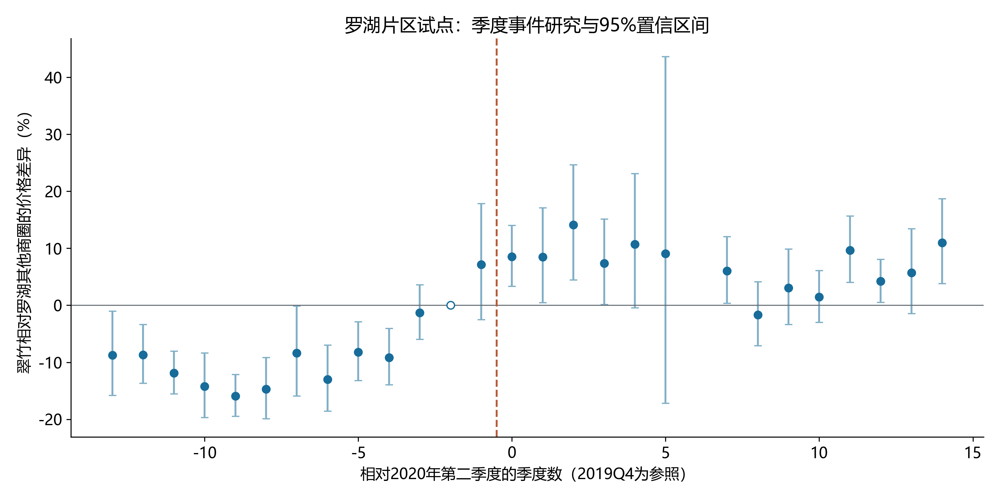
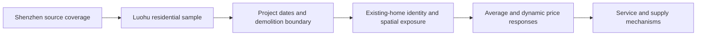

<div align="center">

# Shenzhen Housing Redevelopment

**深圳住宅拆除重建与周边既有住宅价格研究**

Citywide Data Coverage · Luohu Case Study · Spatial Measurement · Event-study Diagnostics

[](https://github.com/sjkncs/shenzhen-housing-redevelopment/stargazers)
[](https://github.com/sjkncs/shenzhen-housing-redevelopment/forks)
[](https://github.com/sjkncs/shenzhen-housing-redevelopment/commits/main)
[](https://github.com/sjkncs/shenzhen-housing-redevelopment/actions/workflows/checks.yml)

[全市数据](scopes/shenzhen/README.md) · [罗湖案例](scopes/luohu/README.md) · [研究设计](docs/RESEARCH_DESIGN.md) · [复现指南](docs/REPRODUCTION.md) · [数据访问](docs/DATA_ACCESS.md)

</div>

---

## Overview

城市更新不仅改变建筑，也改变既有住宅周边的服务、交通与供给预期。本项目关注**拆除重建对周边既有住宅成交价格的影响**：价格何时开始响应，长期收益与暂时施工成本如何区分，空间条件如何改变价格变化的幅度。

采用“**全市数据基础 → 罗湖样本 → 木头龙主案例**”的收敛路径。全市部分组织数据覆盖与清洗汇总；罗湖部分开展片区比较和项目识别准备。两个范围独立存放，不将全市数据量等同于全市政策效应证据。

## Two Research Scopes

| | Shenzhen / 全市 | Luohu / 罗湖 |
| :--- | :--- | :--- |
| 主要用途 | 来源覆盖、清洗、行政区汇总 | 住宅识别、项目事件与片区动态比较 |
| 交易记录 | 原始139,514条；规则清洗后132,774条 | 清洗后16,199条，621个小区 |
| 观测范围 | 2010-01-01至2024-04-25 | 清洗样本至2024-04-24；回归窗口2017—2023年 |
| 已运行分析 | 区级样本覆盖统计 | 片区代理DID、动态路径和敏感性检验 |
| 研究状态 | 数据基础，未估计全市更新因果效应 | 项目红线DID尚待空间归属 |
| 入口 | [scopes/shenzhen](scopes/shenzhen) | [scopes/luohu](scopes/luohu) |

以上统计来自用户提供的平台交易文件，**不是深圳官方成交普查**。清洗规则、来源哈希与分区统计见[全市说明](scopes/shenzhen/README.md)。

## Empirical Preview



*罗湖片区代理事件研究，95%置信区间；参照期为2019Q4。图中2021Q4的处理组交易缺失不插值。*

已有双向固定效应回归比较来源中的翠竹商圈与罗湖其他商圈，主样本10,867笔交易、607个小区。控制面积和电梯后的事后交互系数为0.1606，对应相对差异约17.42%（95%区间11.62%—23.52%）。

**这不是木头龙项目的因果估计。** 事件前联合检验F=12.325、p≈3.94×10⁻²¹，当前设定存在明显事件前变化。显著的事后系数不能替代项目边界、比较组与平行趋势核验。完整数值见[基准表](scopes/luohu/outputs/price_did_audit_20261003/main_did.csv)与[执行摘要](scopes/luohu/outputs/price_did_audit_20261003/run_summary.json)。

## Research Workflow



目前全市覆盖汇总、罗湖片区试算和POI名称核验已完成；正式项目归属、项目ATT、距离衰减及机制估计仍在准备。六个指定候选项目包括木头龙、金钻豪园、三九花园、广场北、红岗花园与第一幼儿园宿舍楼；它们不是全区完整名录，也不是已接受的六个处理组。

## Quick Start

```bash
git clone https://github.com/sjkncs/shenzhen-housing-redevelopment.git
cd shenzhen-housing-redevelopment
python -m pip install -r requirements.txt
python -m unittest discover -s scopes/luohu/tests -p "test_luohu_*.py"
python scripts/validate_public_repository.py
```

测试与汇总核验不需要原始数据。重估模型需要有权使用的交易文件；POI筛选还需要相应源组件。运行路径通过环境变量配置，详见[复现指南](docs/REPRODUCTION.md)。

## Repository Map

```text
scopes/
  shenzhen/                 全市清洗汇总、分区覆盖及汇总代码
  luohu/                    罗湖项目索引、分析代码、检验结果与测试
docs/                       研究设计、数据访问、复现及公开说明
scripts/                    公开文件和结果一致性核验
.github/workflows/          数据无关测试与公开内容检查
```

原始交易、POI明细、空间数据库、报告和PPT已在私有研究档案中管理。公开版当前不再分发这些文件，原因是数据授权和个人材料需要单独处理，而不是将它们视为不重要。可访问范围与访问方式见[数据访问说明](docs/DATA_ACCESS.md)。

## Roadmap

- [x] 区分全市数据基础与罗湖案例研究。
- [x] 保留真实片区回归、动态路径及事件前诊断。
- [x] 用行政代码提取罗湖POI，保护名称中的分期、院区和楼栋限定词。
- [ ] 配准木头龙拆除红线，独立核验既有住宅位置和项目归属。
- [ ] 构造可比较样本并核对同期政策与提前预期。
- [ ] 在资料充分时开展正式项目效应、距离及机制检验。

## Community & Star History

[GitHub Stars](https://github.com/sjkncs/shenzhen-housing-redevelopment/stargazers) · [提交记录](https://github.com/sjkncs/shenzhen-housing-redevelopment/commits/main) · [Issues](https://github.com/sjkncs/shenzhen-housing-redevelopment/issues) · [Star History](https://www.star-history.com/#sjkncs/shenzhen-housing-redevelopment&Date)

Stars徽章读取真实仓库统计。新仓库没有历史积累时不绘制虚构增长曲线；Star History入口随真实记录增长可查看趋势。欢迎提出来源纠错、坐标核验与识别设计建议；请勿在Issue上传个人住宅记录或未经授权的数据库。

## Citation & Terms

本项目是进行中的研究工作，不是已发表论文。引用代码或结果时请标明仓库URL、提交号和访问日期，不构造不存在的论文题名或DOI。

第三方坐标数学实现固定到`googollee/eviltransform`提交`03ba58d92dfda57f8a1635f3805483c8fc10bd77`，原LICENSE随文件保留。公开可读不等于所有文件自动获得再许可；当前没有给第三方数据或项目整体授予统一开源许可，详见[公开说明](docs/PUBLICATION.md)。
