# 住宅定位人工审查图册

三种假设各以自己的候选点居中，范围均为180×180声明投影单位。不同面板不是同一地理位置，不能凭面板形状作直接重叠比较。

红十字为假设点，虚线为50米诊断半径，蓝色为全部半径内建筑，标注数字为原建筑行序号（对应LUOHU_SRC_编号），不是楼栋名称。

建筑源仅按声明WGS84解释；没有卫星影像、官方地址落点或木头龙红线。不能凭蓝色轮廓、落点或最近距离接受真实住宅身份。

按窗口成交数排序，优先审查数据影响较大的候选。索引和每张图哈希见review_atlas_index.csv。面板候选数量已逐个与此前60条诊断记录核对一致。

## 京基东方华都（118笔）

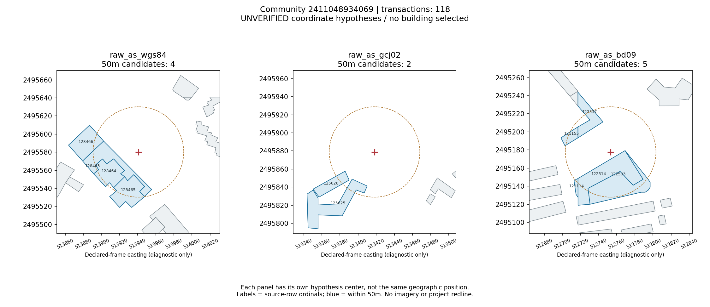

## 环岛丽园（53笔）

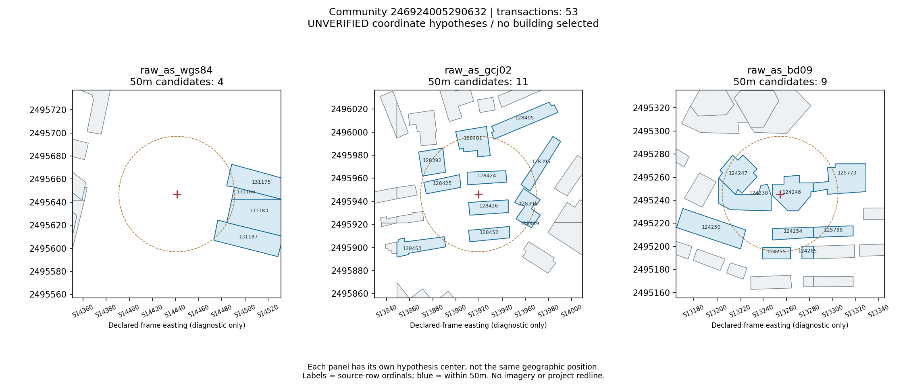

## 阳光绿地家园（38笔）

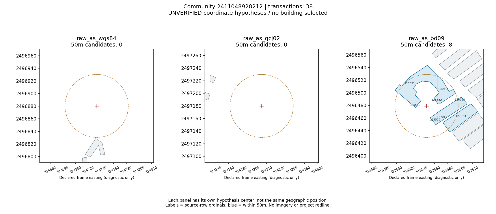

## 华丽花园（31笔）

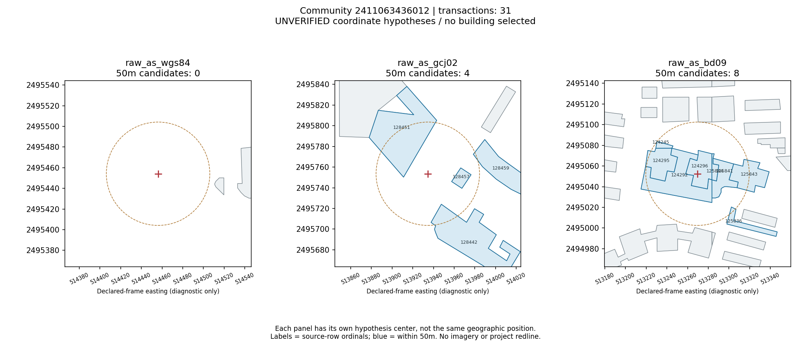

## 蓝馨苑（25笔）

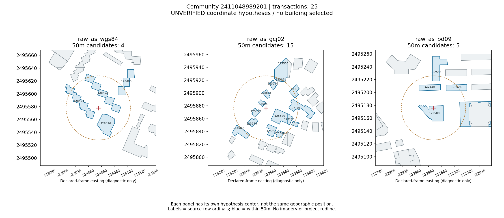

## 泰宁花园（23笔）

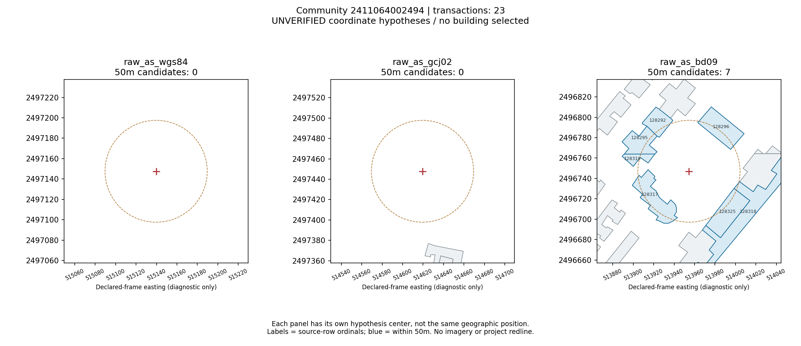

## 东湖丽苑（13笔）

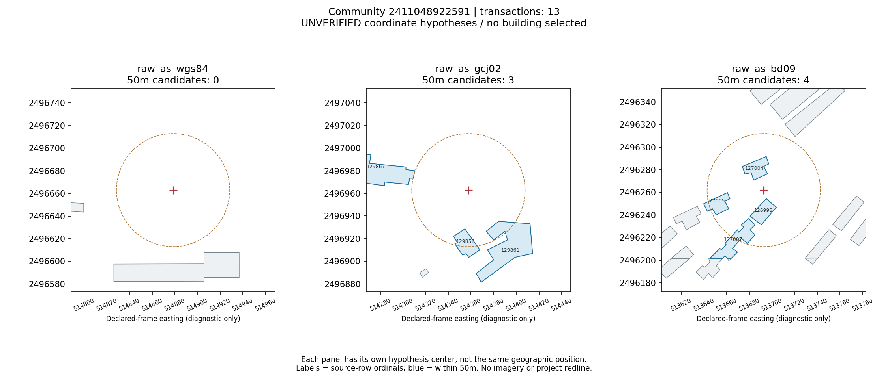

## 集浩花园（12笔）

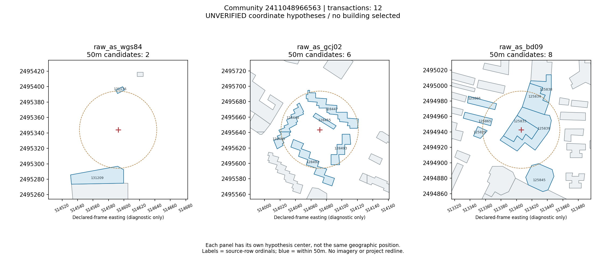

## 中山花园大厦（12笔）

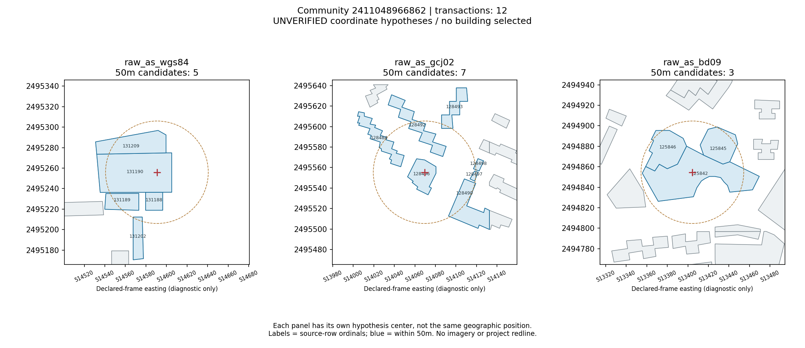

## 翠华花园（12笔）

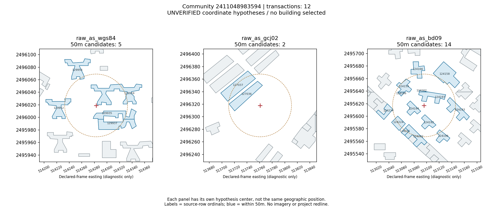

## 华丽西村（9笔）

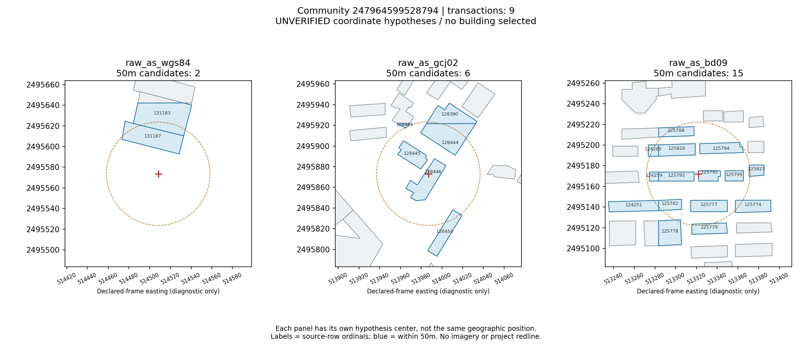

## 名都大厦（8笔）

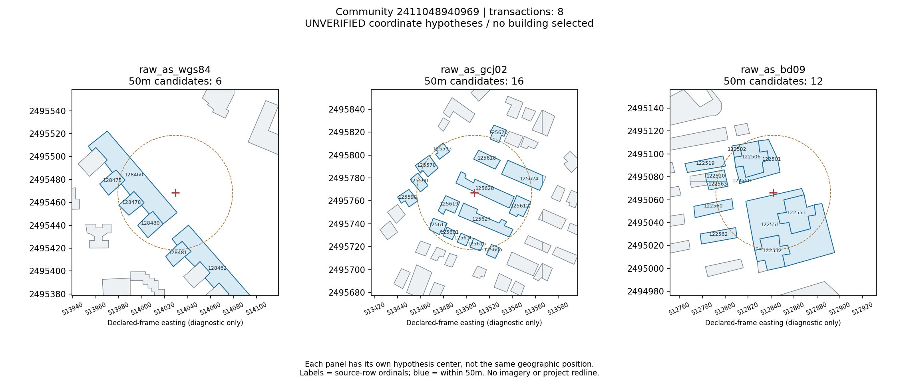

## 金盾花园（3笔）

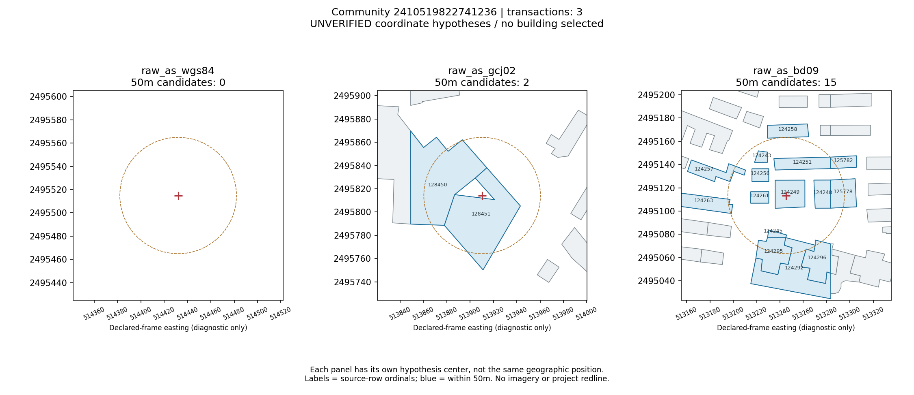

## 华丽小区（2笔）

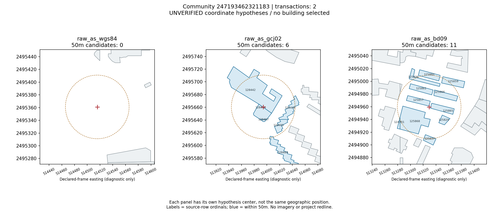

## 外贸大院（2笔）

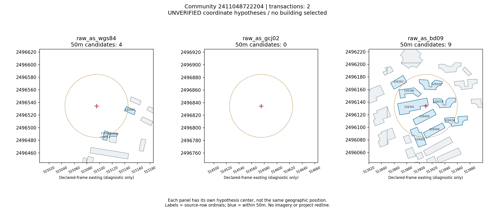

## 广东基础楼（1笔）

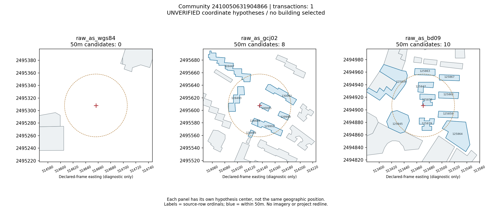

## 湖滨阁（1笔）

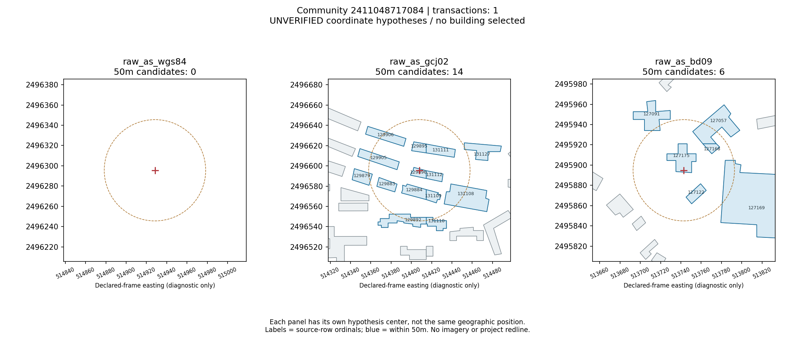

## 万科俊园（1笔）

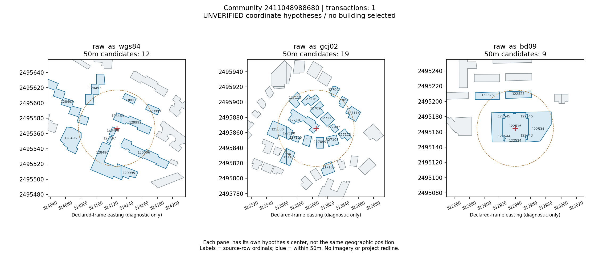

## 华深公寓（1笔）

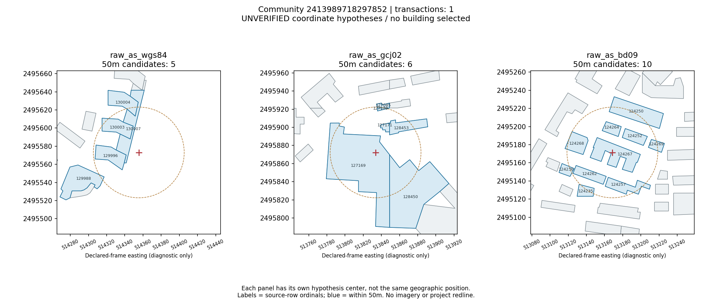

## 传麒东湖名苑（1笔）

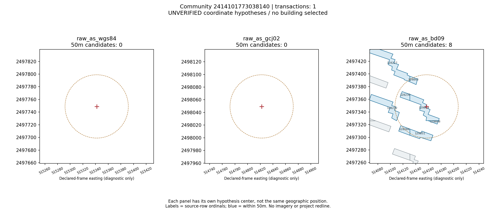

<!-- generated-file-guide:start -->
## 逐文件中文说明

文件说明以当前跟踪版本为准；代码仅说明用途，不导入或执行。

### [review_2410050631904866_0.png](review_2410050631904866_0.png)

三种坐标假设的候选轮廓人工核查图，各面板独立中心，不认证住宅或地图位置；编号为源行序号。

### [review_2410519822741236_0.png](review_2410519822741236_0.png)

三种坐标假设的候选轮廓人工核查图，各面板独立中心，不认证住宅或地图位置；编号为源行序号。

### [review_2411048717084_0.png](review_2411048717084_0.png)

三种坐标假设的候选轮廓人工核查图，各面板独立中心，不认证住宅或地图位置；编号为源行序号。

### [review_2411048722204_0.png](review_2411048722204_0.png)

三种坐标假设的候选轮廓人工核查图，各面板独立中心，不认证住宅或地图位置；编号为源行序号。

### [review_2411048922591_0.png](review_2411048922591_0.png)

三种坐标假设的候选轮廓人工核查图，各面板独立中心，不认证住宅或地图位置；编号为源行序号。

### [review_2411048928212_0.png](review_2411048928212_0.png)

三种坐标假设的候选轮廓人工核查图，各面板独立中心，不认证住宅或地图位置；编号为源行序号。

### [review_2411048934069_0.png](review_2411048934069_0.png)

三种坐标假设的候选轮廓人工核查图，各面板独立中心，不认证住宅或地图位置；编号为源行序号。

### [review_2411048940969_0.png](review_2411048940969_0.png)

三种坐标假设的候选轮廓人工核查图，各面板独立中心，不认证住宅或地图位置；编号为源行序号。

### [review_2411048966563_0.png](review_2411048966563_0.png)

三种坐标假设的候选轮廓人工核查图，各面板独立中心，不认证住宅或地图位置；编号为源行序号。

### [review_2411048966862_0.png](review_2411048966862_0.png)

三种坐标假设的候选轮廓人工核查图，各面板独立中心，不认证住宅或地图位置；编号为源行序号。

### [review_2411048983594_0.png](review_2411048983594_0.png)

三种坐标假设的候选轮廓人工核查图，各面板独立中心，不认证住宅或地图位置；编号为源行序号。

### [review_2411048988680_0.png](review_2411048988680_0.png)

三种坐标假设的候选轮廓人工核查图，各面板独立中心，不认证住宅或地图位置；编号为源行序号。

### [review_2411048989201_0.png](review_2411048989201_0.png)

三种坐标假设的候选轮廓人工核查图，各面板独立中心，不认证住宅或地图位置；编号为源行序号。

### [review_2411063436012_0.png](review_2411063436012_0.png)

三种坐标假设的候选轮廓人工核查图，各面板独立中心，不认证住宅或地图位置；编号为源行序号。

### [review_2411064002494_0.png](review_2411064002494_0.png)

三种坐标假设的候选轮廓人工核查图，各面板独立中心，不认证住宅或地图位置；编号为源行序号。

### [review_2413989718297852_0.png](review_2413989718297852_0.png)

三种坐标假设的候选轮廓人工核查图，各面板独立中心，不认证住宅或地图位置；编号为源行序号。

### [review_2414101773038140_0.png](review_2414101773038140_0.png)

三种坐标假设的候选轮廓人工核查图，各面板独立中心，不认证住宅或地图位置；编号为源行序号。

### [review_246924005290632_0.png](review_246924005290632_0.png)

三种坐标假设的候选轮廓人工核查图，各面板独立中心，不认证住宅或地图位置；编号为源行序号。

### [review_247193462321183_0.png](review_247193462321183_0.png)

三种坐标假设的候选轮廓人工核查图，各面板独立中心，不认证住宅或地图位置；编号为源行序号。

### [review_247964599528794_0.png](review_247964599528794_0.png)

三种坐标假设的候选轮廓人工核查图，各面板独立中心，不认证住宅或地图位置；编号为源行序号。

### [review_atlas_index.csv](review_atlas_index.csv)

住宅审查图册的小区名称、成交支持、文件名与图像哈希索引。

<!-- generated-file-guide:end -->
